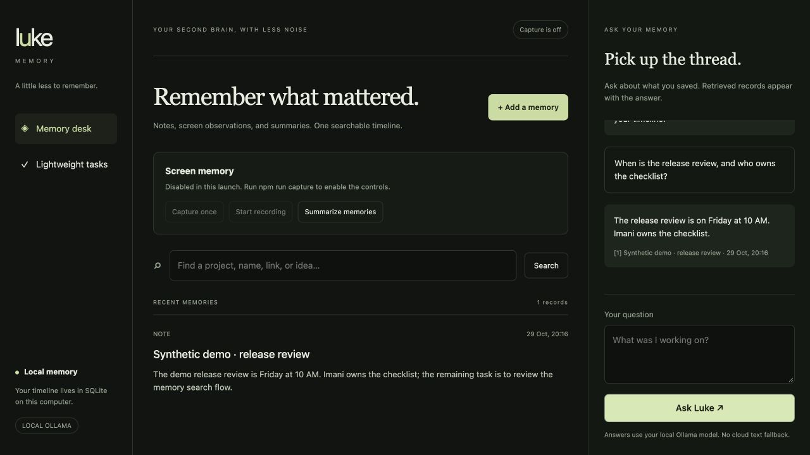

# Luke Memory

**A second brain with a smaller job: remember, retrieve, and help you follow up.**

An always-on-top Electron companion: a small draggable widget stays on your
screen, and clicking it opens an anchored chat panel. Recall saved memories,
add notes, and manage lightweight tasks without opening a separate chat window. Screen recording is
off on launch and can only start through an explicit user action.



This is a focused continuation of the collaborative Luke-os project. See
[NOTICE.md](NOTICE.md) for attribution and the retained [MIT license](LICENSE).

## Included

- **Desktop companion:** click the floating widget to chat; click away or press
  Escape to tuck chat away. Cmd/Ctrl+Shift+Space toggles chat from any app. Drag
  the widget to reposition it; its position is remembered across launches.
- **Memory desk (optional library):** a light workspace with timestamped cards, source filters,
  readable long memories, and a focused note editor.
- **Search:** SQLite FTS5 retrieval across saved titles and memory content.
- **Recall chat:** relevant records are supplied to the model and shown alongside
  its answer. Reference markers are model-generated, not independently verified citations.
- **Summaries:** summarize recent memories on demand; an active recording session
  also summarizes accumulated observations about every two minutes.
- **Tasks:** add a task, mark it complete by stable ID, and see the pending count.
- **Quick navigation:** Cmd/Ctrl+K focuses search; Cmd/Ctrl+N opens a new note.
  The layout adapts to narrow windows, and recall chat shows a pending response state.
- **Optional screen memory:** one-shot or periodic primary-screen observations;
  unchanged screens are skipped. Raw images are transient, not stored on disk.

There are no stress scores, webcam/emotion analysis, clipboard interception,
keyboard/mouse tracking, productivity scoring, focus enforcement, voice coaching,
or counselor reports. This is a desktop app, not a hosted monitoring service.

## Run locally

Python 3.12+ and a Node.js version supported by the pinned Electron release are required.
The current npm scripts use macOS/Linux environment-variable syntax.

```sh
git clone https://github.com/aryanparab/luke-memory.git
cd luke-memory
python3 -m venv .venv
.venv/bin/pip install -r requirements.lock
npm ci
cp .env.example .env
npm start
```

The backend binds to **127.0.0.1:5051**. Electron starts with only the floating
widget visible; chat stays hidden until requested. Use the panel’s library button
or the menu-bar/tray menu to open the full memory library. Quit Luke through the
tray menu. The launcher starts its own backend when needed and stops only that
process on exit; an already running backend is reused. It never starts capture.
Browser access at http://localhost:5051 is an optional development preview.
For backend-only development:

```sh
.venv/bin/python backend/app.py
```

### Local models

Install Ollama and pull a vision-capable model such as the configured default:

```sh
ollama pull gemma3:4b
ollama serve
```

Omit `ollama serve` if the Ollama app is already running. The default text and
vision provider is local Ollama. Model downloads require network access; model
inference needs sufficient memory and can be slow on CPU. Notes, search, and tasks
work without a model server.

To enable capture controls, set `LUKE_ALLOW_CAPTURE=1` in `.env` or run:

```sh
npm run capture
```

Then open the optional memory library and use **Capture once** or **Start recording**. macOS may require Screen
Recording permission for the process performing capture. Pause stops future
captures; an in-flight model request may still finish. Full screen capture and
OS permission flows are not exercised by the automated tests.

### Optional Groq text provider

For faster cloud text chat, set these in your local `.env`:

```dotenv
LUKE_PROVIDER=groq
LUKE_TEXT_MODEL=openai/gpt-oss-20b
GROQ_API_KEY=your_key
```

With this option, questions and retrieved memory excerpts are sent to Groq.
Summaries also send the selected records to Groq. Screen images still go only to
the configured Ollama endpoint. There is no automatic cloud fallback for images
or local model failures. The default Ollama URL is loopback; changing it to a
remote host sends content to that host. Never commit keys or personal memory data.

## Architecture

```text
Electron widget → anchored chat / optional memory library
           │ same-origin local HTTP
           ▼
       Flask API ──────────► SQLite: memories + FTS5 + tasks
           │
           ├── text chat / summary ──► Ollama (default) or Groq (explicit)
           └── opt-in screen capture ──► local Ollama vision
```

Data lives in `.data/memory.sqlite3` by default. Set `LUKE_DATA_DIR` to another
local directory to change it. This repository does not import, copy, or publish
existing `~/.luke` history. SQLite is not encrypted; protect the data directory
like other personal files. No cloud sync or multi-user access is implemented.
The API rejects non-local hosts and cross-origin writes. Do not expose it as a
public backend.

## Checks

```sh
.venv/bin/python -m unittest discover -s tests -v
npm run check
```

Tests cover persistence across store instances, full-text retrieval, task IDs,
retrieved chat context, empty memory, model failure recovery, summary persistence,
input validation, local-host/origin restrictions, and capture being off by default.
Four desktop geometry tests also cover screen edges, secondary monitors, and
offscreen saved positions. The 10 Python tests use synthetic records and a fake provider; they do not
capture a screen. A separate local smoke check verified a real Ollama recall answer
from a synthetic saved note. Screen capture and OS permission flows remain untested.

## Repository layout

```text
backend/app.py       Local routes and request validation
backend/store.py     Transactional SQLite and FTS5
backend/models.py    Explicit local/cloud model adapters
backend/capture.py   Opt-in capture loop and summaries
desktop/main.cjs     Sandboxed Electron shell and backend lifecycle
ui/                 Plain HTML/CSS/JS memory desk, chat and tasks
tests/              Synthetic local regression tests
```

## Current limits

Search uses full-text matching, not semantic vector embeddings. Only the primary
screen is captured. Captured text can include private information visible on that
screen; choose what is visible before enabling recording. There is no packaging,
auto-update, secure-at-rest encryption, or medical/behavioral assessment feature.
